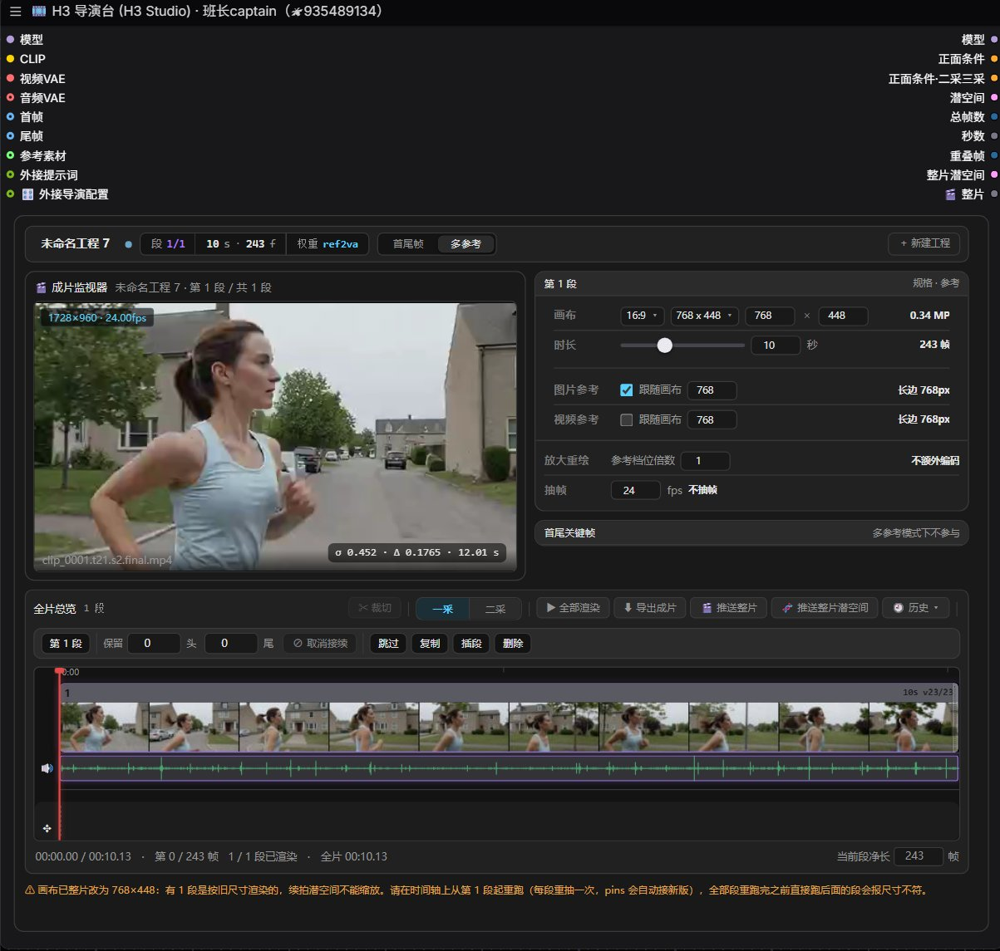
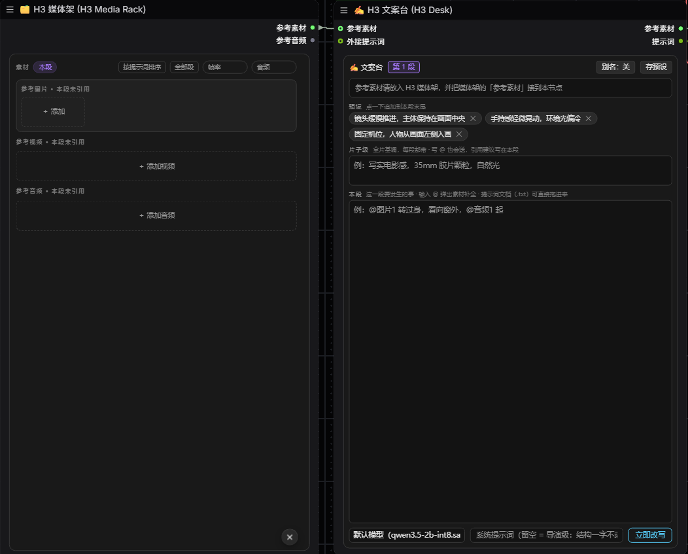

# 班长全家桶 · ComfyUI 自定义节点包

面向 MiniMax H3 长片创作的中文节点集合：多段续写、导演台、AI 制片中枢、钉帧漂移控制、显存管理、文本与字幕工具。

## 安装

1. 把本仓库放到 `ComfyUI/custom_nodes/ComfyUI-Banzhang-All`。
2. **完全重启 ComfyUI**（只刷新网页不生效）。改过 `js/` 里的文件再加 `Ctrl+F5`。
3. Python 依赖见 `requirements.txt`。

## 界面预览

**H3 导演台**：多段续写、成片监视、时间轴与参数集中在一处。

**H3 文案台 ＋ H3 媒体架**：分段文案编辑与参考素材管理。

## 需要自行准备的外部依赖

本仓库不含以下内容，请按各自许可自行获取：

- **ComfyUI-H3-Motion-Context**（GPLv3）：导演台的潜空间续写算术、钉帧切片、栅格校对依赖它。仓库内 `_h3mc/` 为随包保留的一份实现，请同时遵守其自带的 `LICENSE`。
- **MiniMax H3 模型权重**：遵循 MiniMax H3 Community License，有地域与用途限制，不随本仓库分发。
- **NVIDIA VFX / DLSS / Topaz 相关引擎与二进制**：专有组件，不随本仓库分发。相关节点在未安装引擎时不会生效。
- **字体**：界面字体请用系统自带或自行取得授权。

## 许可

本仓库整体采用 **GPL-3.0-or-later**，全文见 `LICENSE`。
第三方组件的来源与各自许可见 `NOTICE.md`；各 vendor 目录内也保留了上游原始 `LICENSE` / `NOTICE`。

## 开源范围

本仓库开源的是**节点代码与运行必需的基础模板**。以下内容不在仓库内，也不随源码分发：

- 成品三采工作流、逐段参数配方、LoRA 搭配与调优提示词
- 模型权重、字体、专有引擎与二进制
- 整理包、安装部署、答疑与代跑服务

仓库内的 `templates/*.json`、`banzhang_translator/prompts/*` 是 AI 制片中枢运行所需的骨架，不含成品工作流参数。
需要完整工作流与配套服务，请通过下方「联系与更新」获取。

## 商业授权

本仓库按 GPL-3.0-or-later 提供，符合 GPL 的使用无需另行联系。

若需在**闭源产品**中使用本项目的自研部分，可通过 GitHub Issues 或下方微信联系作者，单独商议商业授权。

注意：`NOTICE.md` 所列第三方组件（尤其 `_h3mc/`，GPLv3）不在本授权范围内，仍须遵守各自许可。

## 联系与更新

- B 站主页：[班长captain](https://space.bilibili.com/15838129?spm_id_from=333.788.0.0)
- 微信：点开下方二维码放大后扫码

## 问题反馈

请用 GitHub Issues。提交时附上 ComfyUI 版本与终端最后几行报错。
