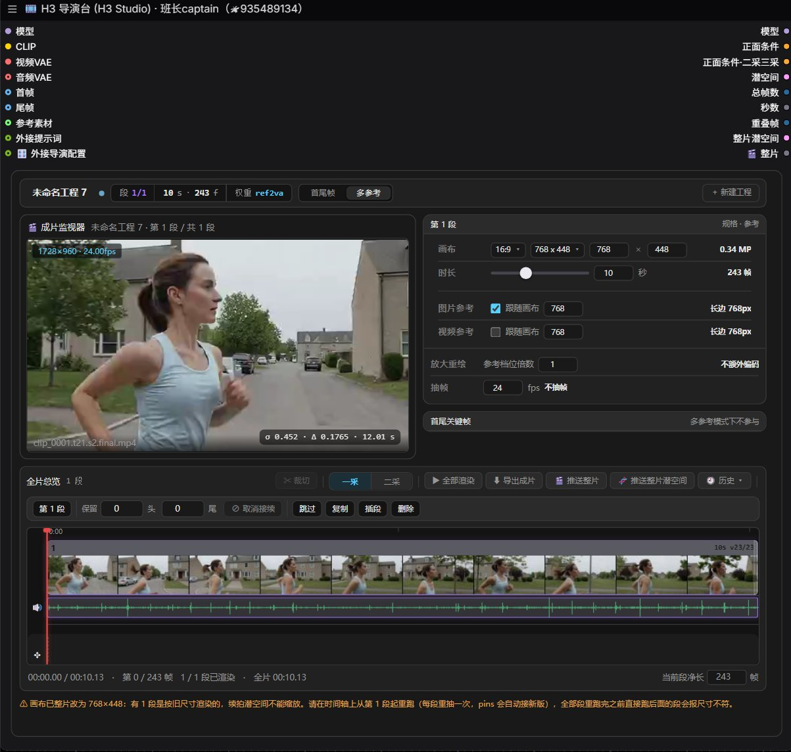
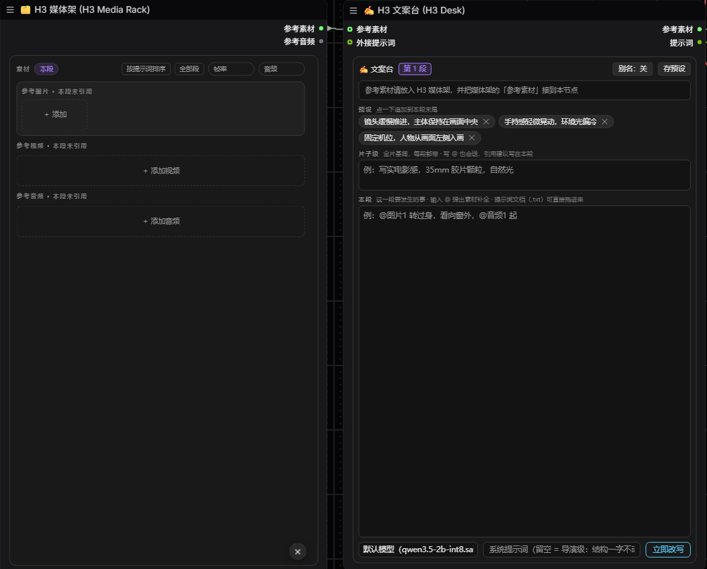
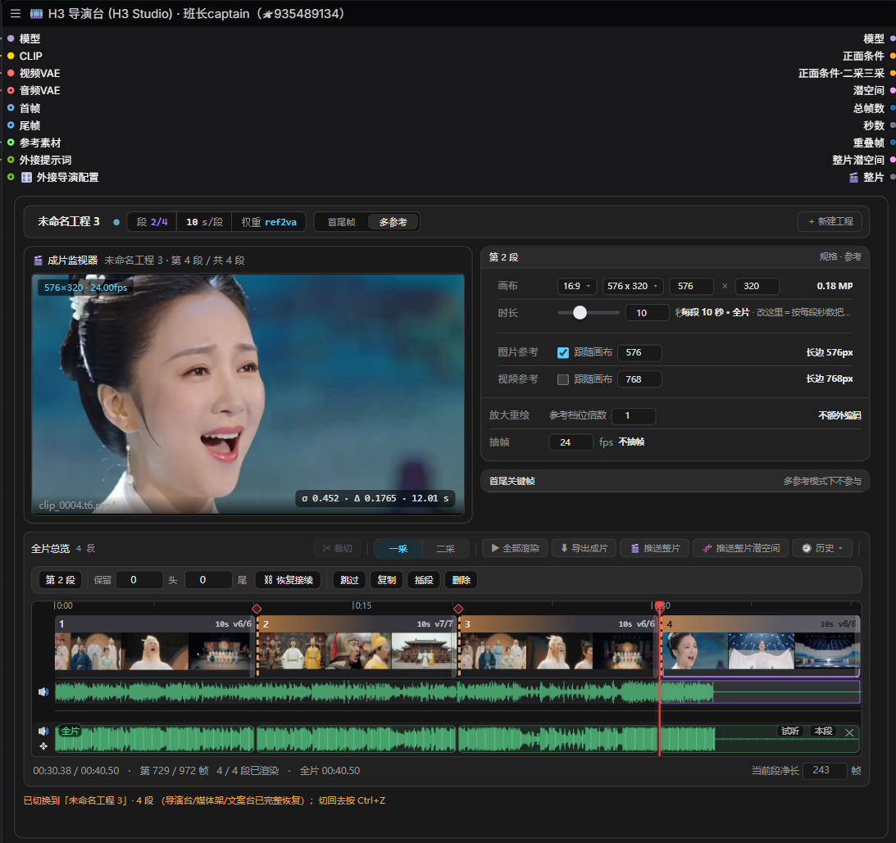

[English](#english) | [中文](#中文)

# English

A Chinese-language ComfyUI custom node pack for video generation with the MiniMax H3 model. Built around the "three-pass" workflow — high-definition video even on a 6 GB GPU.

Includes multi-segment continuation, Director Studio, the AI Producer Hub, pin-frame drift control, VRAM management, plus text and subtitle tools.

## Support the Author

If this pack saves you time, buying the author a coffee is always appreciated — entirely optional, and it unlocks nothing extra.

The codes below are **donation QR codes**; the WeChat QR code in "Contact & Updates" is for adding friends — they are different.

<table>
  <tr>
    <td align="center">WeChat Pay </td>
    <td align="center">Alipay </td>
  </tr>
</table>

## Installation

1. Put this repository into `ComfyUI/custom_nodes/ComfyUI-Banzhang-All`.
2. **Fully restart ComfyUI** (refreshing the web page is not enough). If files under `js/` were changed, press `Ctrl+F5` as well.
3. Python dependencies: see `requirements.txt`.

## UI Preview

**H3 Director Studio**: multi-segment continuation, final-film monitor, timeline and parameters in one place.

**H3 Desk + Media Rack**: segmented script editing and reference asset management.

**Music-video production**: 4-segment continuation with audio waveform alignment, beat-based shot planning and per-segment preview.

## External Components & Licenses

- **Model mirror (Quark netdisk)**: the author keeps all models required by this pack in one place, ready to download:
  [https://pan.quark.cn/s/70186cdde3ab?pwd=Lqse](https://pan.quark.cn/s/70186cdde3ab?pwd=Lqse) (extraction code included in the link).
- **ComfyUI-H3-Motion-Context** (GPLv3): Director Studio's latent-continuation math, tensor slicing and grid checks depend on it. A copy ships in `_h3mc/` under its own `LICENSE`; replace it with an upstream update if needed.
- **MiniMax H3 model weights** (MiniMax H3 Community License, with territory and revenue restrictions), **NVIDIA VFX / DLSS / Topaz proprietary engines and binaries**, and **fonts** are not distributed with this repository; obtain them under their own licenses. Related nodes stay inactive without those engines.

## License

This repository is released under **GPL-3.0-or-later**; see `LICENSE` for the full text.

Sources and licenses of bundled third-party components are listed in `NOTICE.md`; upstream `LICENSE` / `NOTICE` files are kept inside each vendored directory.

## Commercial Use

This repository is provided under GPL-3.0-or-later; GPL-compliant use needs no further contact.

**Content you create with this pack is yours to monetize** — short dramas, ads, music videos, commissions, platform revenue. Such videos, images and audio are your own works, not bound by the GPL: **no extra license, no payment required**. The GPL governs how the code is distributed, not how the output is used.

The only case needing a separate agreement: bundling the code (or a modified version) **into your own closed-source software or product for distribution or sale** while keeping changes private. Reach the author via GitHub Issues or the WeChat QR code below.

Note: model weights carry their own license — the MiniMax H3 Community License has territory and revenue thresholds; confirm before commercial use. Third-party components listed in `NOTICE.md` (notably `_h3mc/`, GPLv3) are outside this authorization and keep their own terms.

## Changelog

### 2026-11-23

- New: **Depth Pro 2** all-in-one node — image/video to depth map, metric depth, colored preview and optional point cloud export.
- New: **H3 reference-conditioning** toolset — AV pack, reference condition, replace-sample, load-video, prompt enhancer, mask blockify / overlay preview.
- New: **subject redraw** crop / uncrop nodes and a shared redraw planner (SAM3-based face detection with static / constant-size / zoom-follow crop modes).
- Reworked: face restoration pipeline split into detection, frames, render and preview modules.
- Repo layout: README screenshots and QR codes moved into `assets/`; release root is now code and config only.

### 2026-11-17

- New: **HD Reseed** — a five-in-one second-pass node: pixel upscale + video/audio VAE encode + AV concat + reference conditioning, with width/height/frames computed internally (no more hand-matching sizes between the condition side and the latent side).
- Reworked to a pure img2img route: dropped CLIP / prompt refit / ref2video calls — second-pass stage time 4m14s → ~1m40s, and the 15 GB Qwen text encoder is no longer loaded.
- Denoise 0.9 → 0.6 (adjustable: 0.3 = polish, 0.7+ = heavy redraw).
- New nodes: HD reseed, Order Anchor, Sigma+LoRA combo, and compatibility aliases.
- Refactor: 59 node modules moved into `nodes/` (one file per node) and 36 shared library modules into `core/`; the package root `__init__.py` now registers everything via `from .nodes import`.
- Director Studio: asset lookup / reference-image reading / Media Rack slot merging now share one code path with the Image Studio; the "full film" output hands downstream video merging a disk path via comfy_api (no re-encode).
- Video Tools: unified ffmpeg lookup (system PATH / bundled / auto-download cache) — no manual ffmpeg install needed.

### 2026-11-15

- Fixed: RelayVSR nodes failing to register on setups without OpenCV (e.g. Comfy-Desktop). Optional third-party imports are now forbidden at module top level in the algorithm layer, enforced by a self-test gate.
- Removed: RelayVSR graphic and text-edge protection, which caused over-sharpening. Frames now go from the model straight to the encoder with no pixel post-processing.
- Added: compatibility aliases for retired nodes so older workflow templates open without missing-node prompts, plus an order-anchor node for multi-pass H3 workflows.

### 2026-11-14

- Refactor: 59 node modules moved into nodes/; shared libraries into core/; root Python files reduced from 115 to 19.
- Docs: AGENTS.md is now the single source of truth; four references to non-existent docs files removed; a placement rule for new .py files added.
- Packaging: release whitelist now includes nodes/; verified by a full three-pass H3 workflow with three MP4 outputs.

### 2026-11-13

- New: H3 Image image-model support in the Image Studio — video-latent static-frame channel layout (24ch, 5-dim with T=1). The prompt-rewrite path needs an external text model (same mechanism as the Desk).
- Asset pool identity migrated from alias to content hash (SQLite schema v5, idempotent self-check with automatic backfill and rebuild).
- Media Rack fallback: when no Desk is on the canvas, the Image Studio now reads the prompts fed by the Media Rack.
- Media Rack drag-sort and reference feeding improvements; new hash selftest for the asset pool.

### v2.1.1 — 2026-11-12

- First public release: 100 nodes.
- Fixed: `core/` subpackage was missing from the release, which made 6 CGlide nodes (Director Studio, Media Rack, Desk, Tail Ref, Join, Legacy Director) fail to load as a group.
- Release integrity: a relative-import completeness check now blocks any release that is missing referenced modules or directories.
- Retired 7 node groups: Topaz Starlight, H3 Clip Archive, Veda sparse attention, H3 Tweaks, Universal Slider, Ignore Groups, Color Picker.
- RelayVSR: downstream-consumer detection — errors are only raised when a downstream node actually consumes the output.
- Model mirror on Quark netdisk added to the README.

## Contact & Updates

- Bilibili: [Banzhang captain](https://space.bilibili.com/15838129?spm_id_from=333.788.0.0)
- WeChat: scan the QR code below to add the author as a friend.

## Feedback

Please open a GitHub Issue and include your ComfyUI version plus the last lines of the terminal log.

---

# 中文

一个面向 MiniMax H3 视频模型视频生成的 ComfyUI 中文插件。主打三采工作流，6GB 显存也能跑高清视频。

内置多段续写、导演台、AI 制片中枢、钉帧漂移控制、显存管理、文本与字幕工具。

## 支持一下

如果这套节点省了时间，欢迎请作者喝杯咖啡。完全自愿，与功能无关。

下面是**打赏码**；后文「联系与更新」里的微信二维码用于加好友，两者不同。

<table>
  <tr>
    <td align="center">微信支付 </td>
    <td align="center">支付宝 </td>
  </tr>
</table>

## 安装

1. 把本仓库放到 `ComfyUI/custom_nodes/ComfyUI-Banzhang-All`。
2. **完全重启 ComfyUI**（只刷新网页不生效）。改过 `js/` 里的文件再加 `Ctrl+F5`。
3. Python 依赖见 `requirements.txt`。

## 界面预览

**H3 导演台**：多段续写、成片监视、时间轴与参数集中在一处。

**H3 文案台 ＋ H3 媒体架**：分段文案编辑与参考素材管理。

**MV 视频制作**：4 段续写配合音频波形，按节拍排片与逐段预览。

## 外部组件与许可说明

- **模型网盘（夸克）**：作者已把本插件所需的全部模型汇总在一个网盘，直接下载即可：
  [https://pan.quark.cn/s/70186cdde3ab?pwd=Lqse](https://pan.quark.cn/s/70186cdde3ab?pwd=Lqse)（提取码已含在链接里）。
- **ComfyUI-H3-Motion-Context**（GPLv3）：导演台的潜空间续写算术、钉帧切片、栅格校对依赖它。仓库内 `_h3mc/` 已随包内置一份实现，遵循其自带 `LICENSE`；如需上游更新可自行替换。
- **MiniMax H3 模型权重**（MiniMax H3 Community License，含地域与营收门槛限制）、**NVIDIA VFX / DLSS / Topaz 专有引擎与二进制**、**字体**：不随本仓库分发，需按各自许可自行获取；相关节点未装引擎时不会生效。

## 许可

本仓库整体采用 **GPL-3.0-or-later**，全文见 `LICENSE`。

第三方组件的来源与各自许可见 `NOTICE.md`；各 vendor 目录内也保留了上游原始 `LICENSE` / `NOTICE`。

## 商业授权

本仓库按 GPL-3.0-or-later 提供，符合 GPL 的使用无需另行联系。

**用本插件做出来的内容可以随便赚钱**：短剧、广告、MV、接单、平台投稿变现 —— 生成的视频／图片／音频属于你的作品，不受 GPL 约束，**无需另行授权，也无需付费**。GPL 约束的是代码的分发，不是作品的使用。

需要单独商议的只有一种情况：把插件代码（或改动版）**打包进自己的闭源软件／产品对外分发或销售**，且不愿公开改动。这种可通过 GitHub Issues 或下方微信联系作者。

注意：模型权重有独立许可，MiniMax H3 Community License 含地域与营收门槛等限制，商用前请自行确认；`NOTICE.md` 所列第三方组件（尤其 `_h3mc/`，GPLv3）也不在可授权范围内，仍须遵守各自许可。

## 更新日志

### 2026-11-23

- 新增：**深度估计 Pro2** 一体化节点 —— 图片/视频 → 深度图、米制深度、着色预览与可选点云导出。
- 新增：**H3 参考条件**工具组 —— AV 打包、参考条件、替换采样、加载视频、提示词增强、遮罩分块／叠加预览。
- 新增：**主体重绘**裁剪／还原节点与共用重绘规划器（基于 SAM3 的人脸检测，支持静止大框／恒尺寸跟随／变焦跟随三种裁剪模式）。
- 重构：人脸修复流程拆分为检测、逐帧、渲染、预览四个模块。
- 仓库整理：README 截图与二维码归入 `assets/`，发布层根目录只留代码与配置。

### 2026-11-17

- 新增：**HD 重播种** —— 二采五合一节点：像素放大＋视频/音频 VAE 编码＋AV 拼接＋参考条件收进一个节点；宽/高/帧数内部统一计算，不再手抄条件端与潜空间端的尺寸。
- 改为纯 img2img 路线：砍掉 CLIP／修复提示词／ref2video 调用——二采阶段耗时 4分14秒 → 约1分40秒，不再装载 15GB 的 Qwen 文本编码器。
- 重绘幅度 0.9 → 0.6（可调：0.3 = 抛光，0.7 以上 = 大幅重画）。
- 新增节点：HD 重播种、顺序锚、Sigma+LoRA 组合、兼容别名。
- 重构：59 个节点模块归位 `nodes/`（一节点一文件），36 个共用库模块归位 `core/`；包根 `__init__.py` 统一 `from .nodes import` 注册。
- 导演台：素材定位／参考图读取／媒体架槽位合并与 Qwen 编辑台共用同一份口径；「整片」输出口通过 comfy_api 把磁盘路径交给下游视频合并，不再重编码。
- 视频工具：ffmpeg 查找统一（系统 PATH／插件自带／首次自动下载缓存），拿到插件包不用再自己装 ffmpeg。

### 2026-11-15

- 修复：未安装 opencv 的环境（如 Comfy-Desktop）里 RelayVSR 三个节点整组不注册；算法层顶层禁止可选第三方依赖，并加了自检闸门。
- 移除：RelayVSR 字幕/台标图形区保护（反馈锐化过重）；现在模型出帧直接进编码器，不做像素后处理。
- 新增：已注销节点的兼容别名，旧模板打开不再弹「节点缺失」；三采工作流用的「🔗 顺序锚」节点。

### 2026-11-14

- 重构：59 个节点归位到 nodes/，共用库集中到 core/，根目录 Python 文件从 115 个降到 19 个。
- 文档：AGENTS.md 升格为唯一事实源，注销 4 个从未存在的 docs 文档引用，新增 .py 归位约定。
- 发布：发布层白名单加入 nodes/；已用完整三采工作流验证（三个 mp4 均出片）。

### 2026-11-13

- 新增：图像编辑台支持 H3 Image 图像模型 —— 视频潜空间静态帧通道（24 通道、5 维含 T=1）；提示词改写需外接独立文本模型（同文案台机制）。
- 素材池身份从 alias 迁移到内容哈希（数据库 schema v5，幂等自检，自动补填与重建）。
- 媒体架兜底：画布上没有文案台时，图像编辑台改读媒体架喂入的提示词。
- 媒体架拖拽排序与引用喂入优化；素材池新增哈希自测。

### v2.1.1 — 2026-11-12

- 首次公开版本：100 个节点。
- 修复：发布包缺 `core/` 子包，导致导演台、媒体架、文案台、参照图替换、续接合成、经典版导演台整组加载失败。
- 发布完整性：新增相对导入完整性检查，缺被引用的模块/目录会拒绝发布。
- 注销 7 组节点：Topaz 星光、H3 续拍存档、Veda 稀疏注意力、H3 画面微调、万能滑条、忽略多组、取色器。
- RelayVSR：新增下游消费检测，仅在下游真的接线时才报错。
- README 增加模型网盘链接。

## 联系与更新

- B 站主页：[班长captain](https://space.bilibili.com/15838129?spm_id_from=333.788.0.0)
- 微信：点开下方二维码放大后扫码

## 问题反馈

请用 GitHub Issues，提交时附上 ComfyUI 版本与终端最后几行报错。
