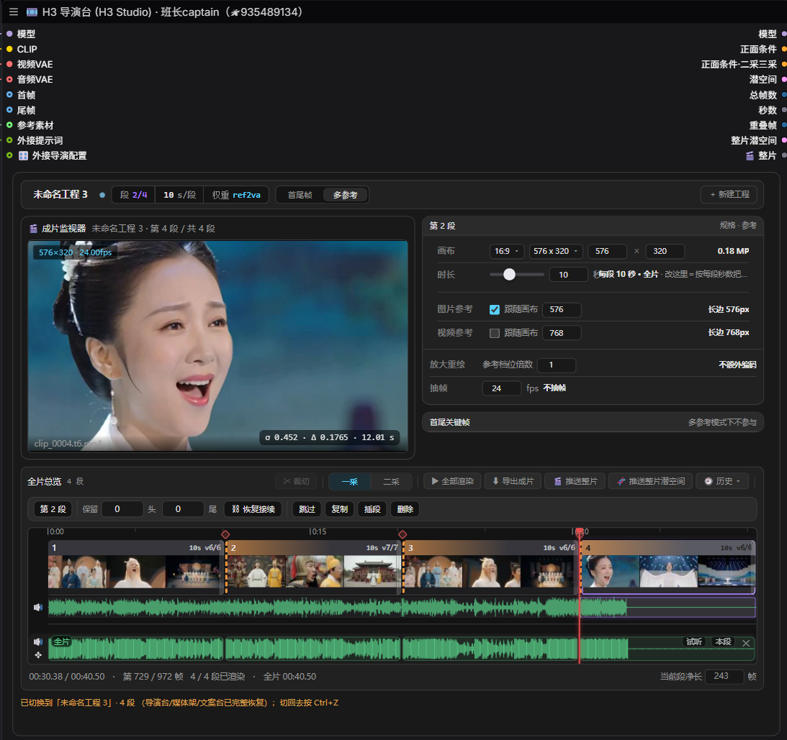

# 班长全家桶 · ComfyUI 自定义节点包

用 MiniMax H3 视频模型生成视频的 ComfyUI 中文插件。主打三采工作流，6GB 显存也能跑高清视频。

内置多段续写、导演台、AI 制片中枢、钉帧漂移控制、显存管理、文本与字幕工具。

## 支持一下

如果这套节点省了时间，欢迎请作者喝杯咖啡。完全自愿，与功能无关。
下面是**打赏码**；后文「联系与更新」里的微信二维码用于加好友，两者不同。

<table>
  <tr>
    <td align="center">微信支付 </td>
    <td align="center">支付宝 </td>
  </tr>
</table>

## 安装

1. 把本仓库放到 `ComfyUI/custom_nodes/ComfyUI-Banzhang-All`。
2. **完全重启 ComfyUI**（只刷新网页不生效）。改过 `js/` 里的文件再加 `Ctrl+F5`。
3. Python 依赖见 `requirements.txt`。

## 界面预览

**H3 导演台**：多段续写、成片监视、时间轴与参数集中在一处。

**H3 文案台 ＋ H3 媒体架**：分段文案编辑与参考素材管理。

**MV 视频制作**：4 段续写配合音频波形，按节拍排片与逐段预览。

## 外部组件与许可说明

- **ComfyUI-H3-Motion-Context**（GPLv3）：导演台的潜空间续写算术、钉帧切片、栅格校对依赖它。仓库内 `_h3mc/` 已随包内置一份实现，遵循其自带 `LICENSE`；如需上游更新可自行替换。
- **MiniMax H3 模型权重**（MiniMax H3 Community License，含地域与营收门槛限制）、**NVIDIA VFX / DLSS / Topaz 专有引擎与二进制**、**字体**：不随本仓库分发，需按各自许可自行获取；相关节点未装引擎时不会生效。

## 许可

本仓库整体采用 **GPL-3.0-or-later**，全文见 `LICENSE`。
第三方组件的来源与各自许可见 `NOTICE.md`；各 vendor 目录内也保留了上游原始 `LICENSE` / `NOTICE`。

## 联系与更新

- B 站主页：[班长captain](https://space.bilibili.com/15838129?spm_id_from=333.788.0.0)
- 微信：点开下方二维码放大后扫码

## 问题反馈

请用 GitHub Issues。提交时附上 ComfyUI 版本与终端最后几行报错。
